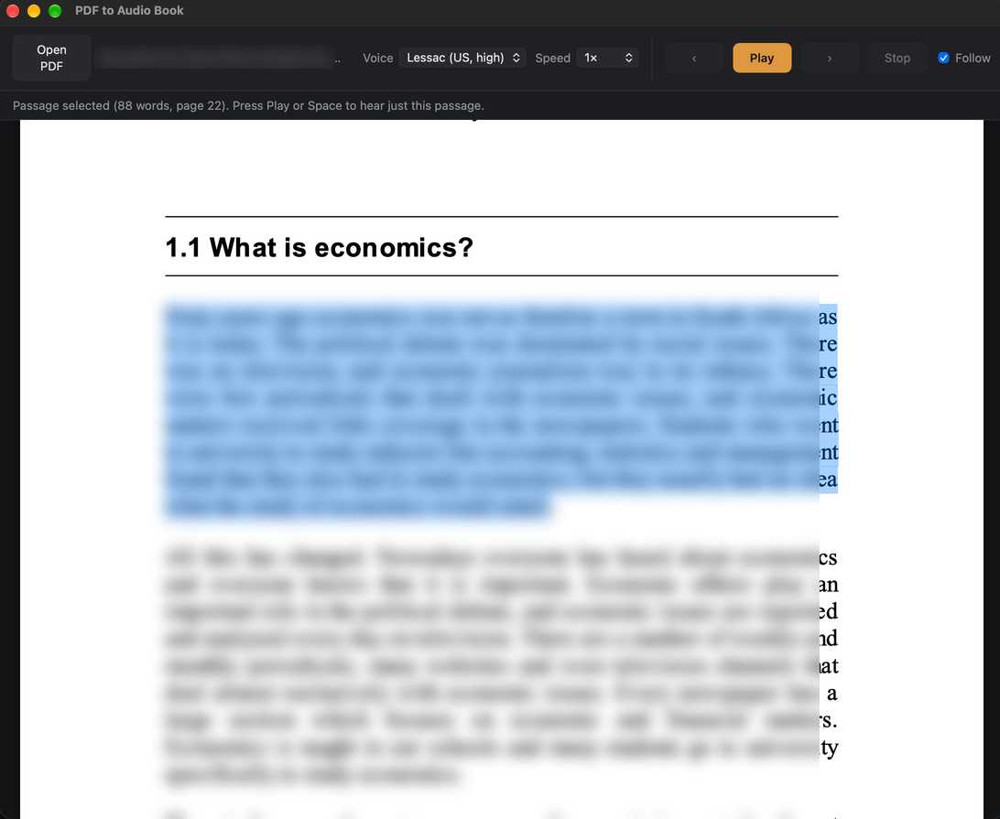

# PDF Study Reader

A macOS study tool that reads PDFs aloud with a natural-sounding neural voice. Click any word to start reading from there, or select a passage to hear just that part. The spoken sentence is highlighted and the page follows along.

Everything runs locally: no cloud services, no accounts, and nothing is saved except where you stopped reading.

<p align="center"></p>

## Features

- **Click to read.** Click a word and press Play to read from that point on.
- **Passage mode.** Drag-select text to hear only that passage.
- **Follow along.** The current sentence is highlighted and the page auto-scrolls; scrolling yourself pauses *Follow*.
- **Sentence navigation.** ← / → step back and forward a sentence while listening.
- **Resume where you left off.** Reopening a PDF puts the marker at your last position.
- **Clean reading.** Running headers and footers that repeat on every page are detected and skipped.
- **Multiple voices.** Any [Piper](https://github.com/rhasspy/piper) voice can be added and picked from the Voice menu.
- **Keyboard first.** Space play/pause · Esc stop · ⌘O open a PDF.

## How it works

| Part | What it does |
| --- | --- |
| `app.py` | Desktop app shell: opens a native window around the web UI and bridges it to Python |
| `engine.py` | Text-to-speech engine: splits text into sentences and streams Piper audio as you listen |
| `web/` | Reader UI: renders PDFs with [PDF.js](https://mozilla.github.io/pdf.js/), maps clicks and selections to text, highlights the spoken sentence |
| `make_launcher.sh` | Builds a double-clickable `.app` launcher on the Desktop |

Speech is generated on the fly, sentence by sentence, so playback starts immediately even on long documents.

## Setup (macOS)

Requires Python 3.

```bash
git clone https://github.com/ryan-hall-dev/pdf-study-reader.git
cd pdf-study-reader
python3 -m venv .venv && source .venv/bin/activate
pip install -r requirements.txt
python -m piper.download_voices en_US-lessac-high --download-dir voices
chmod +x make_launcher.sh && ./make_launcher.sh
```

That puts **PDF to Audio Book.app** on your Desktop. Double-click it and choose a PDF.

More voices:

```bash
python -m piper.download_voices                                         # list voices
python -m piper.download_voices en_US-ryan-high --download-dir voices   # add one
```

## Troubleshooting

Errors are written to `app.log`. Run `python app.py` from a terminal to see them live. If you move the folder, run `./make_launcher.sh` again.

## Why I built it

I study long PDF textbooks for my degree and wanted to listen while reading, with precise control over where reading starts. Built by [Ryan Hall](https://github.com/ryan-hall-dev).

PDF.js is included under its [Apache 2.0 license](web/vendor/PDFJS-LICENSE).
